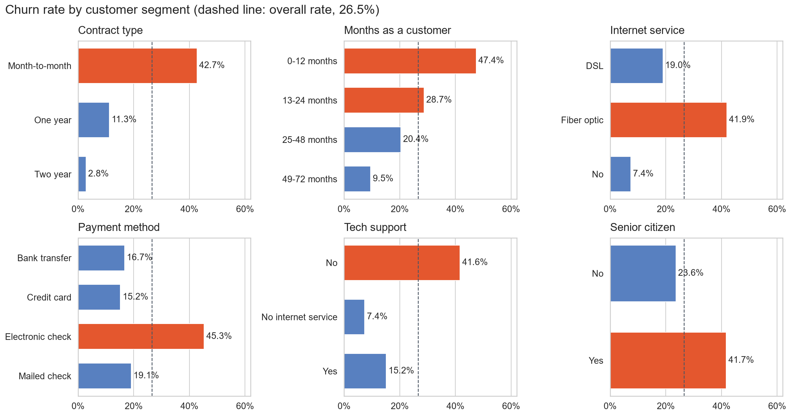
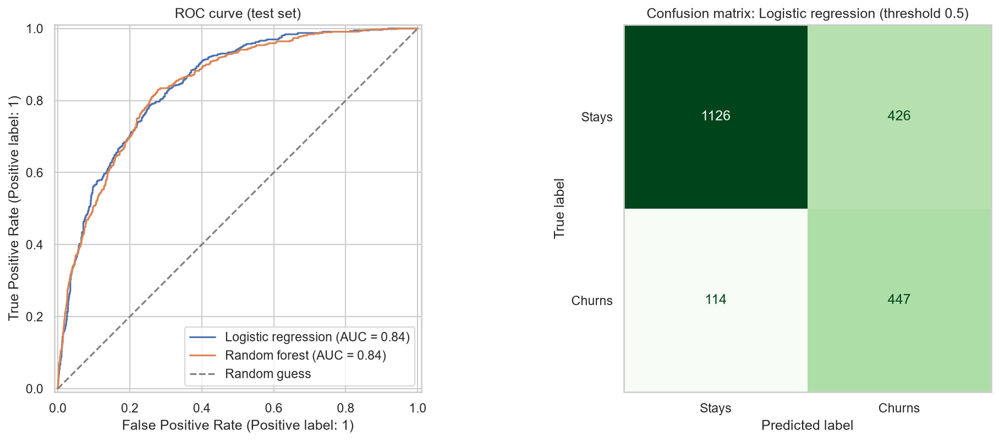

# Telco Customer Churn: who's leaving, why, and what it costs

[](https://github.com/ImIvyzz/telco-churn/actions/workflows/tests.yml)


Predicting which telecom customers will cancel, explaining why, and estimating how much revenue a targeted retention program could protect.



## Key results
| Topic | Result |
|---|---|
| **Churn rate** | 26.5% of customers, taking **30.5% of monthly revenue** ($139k of $456k) |
| **Biggest driver** | Contract type: **42.7%** churn on month-to-month vs. **2.8%** on two-year contracts |
| **Riskiest moment** | First year: **47.4%** churn in months 0–12 vs. 14.0% after month 24 |
| **Model** | Logistic regression: **ROC-AUC 0.84**, catches **80% of churners** (recall) |
| **Targeting** | The high-risk band is **33% of customers but holds 71% of all churners** |
| **Impact (scenario)** | Retaining 20% of high-risk churners protects **~$20.8k/month (~$250k/year)** |

## Approach
1. **Cleaning:** 11 blank `TotalCharges` were all new customers with 0 months of tenure, so they were set to 0 (not imputed).
2. **Exploration:** churn rate by contract, tenure, internet service, payment method, support and age.
3. **Statistical testing:** chi-square tests show which differences are real. Gender and phone service are **not** related to churn.
4. **Modeling:** a scikit-learn `Pipeline` (no data leakage), a stratified split, a "nobody churns" baseline, and logistic regression vs. random forest with 5-fold cross-validation. Evaluated on recall, precision, F1 and ROC-AUC, not accuracy alone.
5. **Interpretation:** odds ratios and permutation importance.
6. **Business impact:** an out-of-fold risk score for every customer, risk bands, and a retention scenario with explicit assumptions.



## Recommendations
- Offer month-to-month customers in the high-risk band an incentive to move to a one-year contract.
- Run a first-90-days onboarding program for new customers.
- Bundle tech support and online security with fiber plans.
- Incentivize automatic payment for electronic-check customers.
- Load the risk score into the CRM and trigger retention tasks automatically for the high-risk band.

## Limitations
- One snapshot of customers, with no time dimension: the model can't say *when* someone will leave.
- Observational data: the drivers are associations, not proven causes. Each recommendation should be tested against a control group.
- The $250k figure is a scenario. The 20% save rate is an assumption and the cost of the offers isn't subtracted; both can be changed with `--save-rate`.

## Repository
```
├── churn_prediction_v2.ipynb   # the analysis as a story, with every chart and table
├── run_analysis.py             # runs the whole pipeline and regenerates outputs/
├── churn/                      # the logic, shared by the notebook, the script and the tests
│   ├── config.py               # paths, constants and scenario assumptions
│   ├── data.py                 # loading and cleaning
│   ├── analysis.py             # churn by segment, chi-square tests
│   ├── model.py                # pipelines, evaluation, model selection, drivers
│   └── impact.py               # risk scores, risk bands, retention scenario
├── tests/test_churn.py         # 10 checks, incl. no data leakage and the baseline comparison
├── data/                       # IBM Telco Customer Churn sample
└── outputs/                    # charts, model results and customer_risk_scores.csv (Power BI input)
```

## Run it
Requires Python 3.11 or newer.
```bash
pip install -r requirements.txt

python run_analysis.py                    # full pipeline, about 30 seconds
python run_analysis.py --save-rate 0.3    # test a different retention assumption
pytest                                    # run the checks
```
The tests also run automatically on every push (GitHub Actions).

## Background
This started as my capstone project for the Data Analytics program at Toronto School of Management (2024). Version 2 (2026) fixes the original's modeling errors (a broken label-encoding model, scaler leakage, accuracy-only evaluation), adds statistical testing and a business-impact layer, and moves the logic into a tested package. The last section of the notebook lists every change.

**Data:** [IBM Telco Customer Churn](https://www.kaggle.com/datasets/blastchar/telco-customer-churn), a public sample dataset of 7,043 customers.
**Author:** Ivan Ignacio Velazquez, Data Analyst. [GitHub](https://github.com/ImIvyzz) · [LinkedIn](https://www.linkedin.com/in/ivan-ignacio-velazquez-b436362b6/) · [Portfolio](https://imivyzz.github.io)
